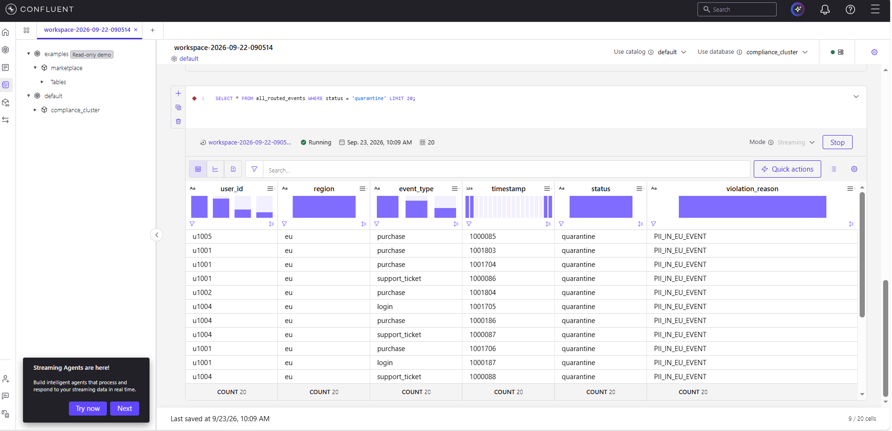
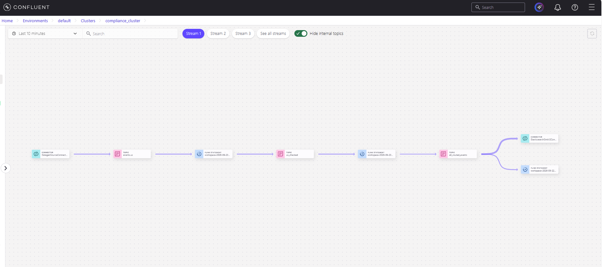
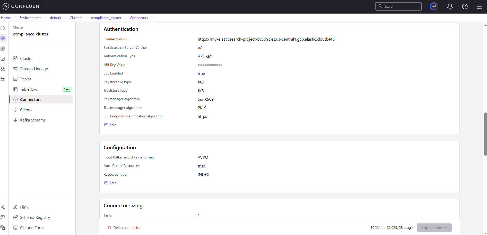
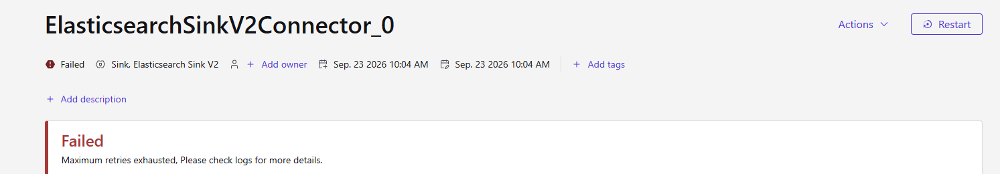

# Multi-Region Compliance-Aware Data Router

A real-time data governance pipeline built on Confluent Cloud. It checks every event against its region's privacy rule **while the data is still moving**, not in an audit after the fact.

Built in ~20 hours for a Confluent challenge.

> **Status:** the live pipeline was shut down in November 2026. The results and screenshots below are from the September 2026 run. Everything needed to rebuild it is in this repo (see [How to Reproduce](#how-to-reproduce)).

## Demo

PASTE_VIDEO_LINK_HERE

## The Problem

Companies that operate in more than one region (EU, US, etc.) have to make sure raw personal data, such as email addresses and phone numbers, does not flow downstream against that region's privacy rules. Checking this after the fact is slow and reactive. This project applies the rule **in-flight**, at the stream level, with every decision traceable.

## Compliance Rules

| Region | Rule | Violation tag |
|---|---|---|
| EU | Any event with a raw email **or** a raw phone number is quarantined | `PII_IN_EU_EVENT` |
| US | Only a raw email triggers quarantine; phone numbers are allowed | `PII_EMAIL_IN_US_EVENT` |

Violations are not pre-labelled. The Datagen connectors fill the `raw_email` and `raw_phone` fields at random (each is null about half the time), so the Flink logic has to actually detect PII rather than filter on a flag it controls.

## Architecture

```
┌─────────────────┐     ┌─────────────────┐
│ Datagen: EU      │     │ Datagen: US      │      ← Source Connectors
└────────┬─────────┘     └────────┬─────────┘
         ↓                        ↓
   topic: events.eu         topic: events.us       ← Schema Registry-validated (Avro)
         ↓                        ↓
┌───────────────────────────────────────────┐
│         Flink SQL — compliance logic         │      ← Stream Processing
│  (per-region rule → status + reason fields) │
└───────────────────────────────────────────┘
         ↓                        ↓
    eu_checked                us_checked
         ↓                        ↓
┌───────────────────────────────────────────┐
│     topic: all_routed_events                │      ← Merged, tagged output
│  (status: clean/quarantine + reason)        │
└───────────────────────────────────────────┘
                    ↓
        Elasticsearch Sink V2 Connector          ← configured (see Known Limitations)
                    ↓
       Stream Catalog + Stream Lineage           ← Governance layer
```

## Confluent Components Used

- **Source connectors:** 2 Datagen Source connectors producing schema-validated EU and US event streams
- **Schema Registry:** Avro schemas ([`eu-schema.json`](eu-schema.json), [`us-schema.json`](us-schema.json)) with nullable `raw_email` / `raw_phone` fields
- **Stream processing (Flink SQL):** per-region rule evaluation, tagging each event with `status` and `violation_reason`, then merging both regions into one governed topic ([`flink-queries.sql`](flink-queries.sql))
- **Sink connector:** Elasticsearch Sink V2 with API-key authentication against an Elastic Cloud serverless project (see Known Limitations)
- **Stream Governance:** Stream Lineage traces the full path from source connector, through each Flink statement, to the sink

## Results (Verified)

```sql
SELECT status, COUNT(*) AS cnt FROM all_routed_events GROUP BY status;
```

- **2,927 events quarantined**
- **2,011 events routed clean**

**Sanity check:** since each PII field is null about 50% of the time, an EU event should be flagged ~75% of the time (email OR phone) and a US event ~50% of the time (email only). With roughly equal traffic that's ~62% expected. The run gave 2,927 / 4,938 = **59%**, which is in line with the rules genuinely detecting random PII.

*(Counts are a snapshot from one streaming run; the query keeps updating while the connectors run.)*

Sample quarantined records:

| user_id | region | event_type | status | violation_reason |
|---|---|---|---|---|
| u1005 | eu | purchase | quarantine | PII_IN_EU_EVENT |
| u1001 | eu | support_ticket | quarantine | PII_IN_EU_EVENT |
| u1004 | eu | login | quarantine | PII_IN_EU_EVENT |



## Governance in Practice

**Stream Lineage** gives an automatically generated trace of the pipeline: from the source topics, through each Flink transformation, to `all_routed_events` and the downstream sink. The compliance decision path is auditable, not a black box.

US stream, source to merged topic:


Full path including the Elasticsearch sink:



## How to Reproduce

1. Create a Confluent Cloud environment and a Basic Kafka cluster, with Stream Governance (Schema Registry) enabled.
2. Add a **Datagen Source** connector → choose to provide your own schema → paste [`eu-schema.json`](eu-schema.json) → output topic `events.eu`, format AVRO.
3. Repeat with [`us-schema.json`](us-schema.json) → topic `events.us`.
4. Create a Flink compute pool in the same region, open a SQL workspace, and select the cluster as the database.
5. Run the statements in [`flink-queries.sql`](flink-queries.sql) in order (Steps 2–4), then the verification queries.
6. Open **Stream Lineage** on the cluster to see the full path.
7. **When you're done, delete the connectors, the Flink compute pool and the cluster.** They are billed by the hour and keep running after you close the browser, and after the free trial credit runs out the charges go to your card. Stopping a Flink statement is not enough on its own.

## Known Limitations

- **Elasticsearch sink did not provision.** The Elasticsearch Sink V2 connector was fully configured (Connection URI, AVRO input, API-key auth, SSL enabled). Write access to the Elastic Cloud serverless deployment was verified separately with `curl` using the same API key, so the credentials and endpoint were valid. The connector still failed with a generic "maximum retries exhausted" message, and the connector logs did not show a specific exception. The root cause was not isolated within the time box, so results are shown through Flink SQL queries and the Stream Lineage graph instead of a live Elasticsearch dashboard.

  
  

- **Events are tagged, not yet split.** Clean and quarantined events currently share one topic (`all_routed_events`) with a status tag, and the intermediate `eu_checked` / `us_checked` topics still hold the raw PII fields. Next steps below close this gap.

## Lessons Learned

- **Tagging is not routing.** Adding a `status` column was quick, but real protection means downstream consumers should never be able to read quarantined data at all.
- **Cloud resources don't stop when the project does.** I stopped the Flink queries I could see but left the connectors, compute pool and cluster running. They used up the trial credit and kept billing for weeks. Now I delete everything the day a project ends and check the billing page before closing the tab.
- **Write down what failed.** The Elasticsearch sink never worked, but documenting the config, the curl test and the error is more useful to the next person than hiding it.

## Next Steps

- Split output into separate `clean_events` and `quarantine_events` topics so downstream consumers only ever subscribe to clean data
- Drop or mask `raw_email` / `raw_phone` in the intermediate topics
- Fix the Elasticsearch sink and add a Kibana dashboard of violations by region over time
- Use real event-time timestamps with watermarks instead of the generator's counter

## What This Demonstrates

- Real stream processing logic with region-specific rules, not just pass-through aggregation
- Confluent connectors on both the ingestion and (configured) egress side
- Governance built into the pipeline's structure, not added on later
- Honest documentation of what works, what was configured but not verified, and why

## License

[MIT](LICENSE)
